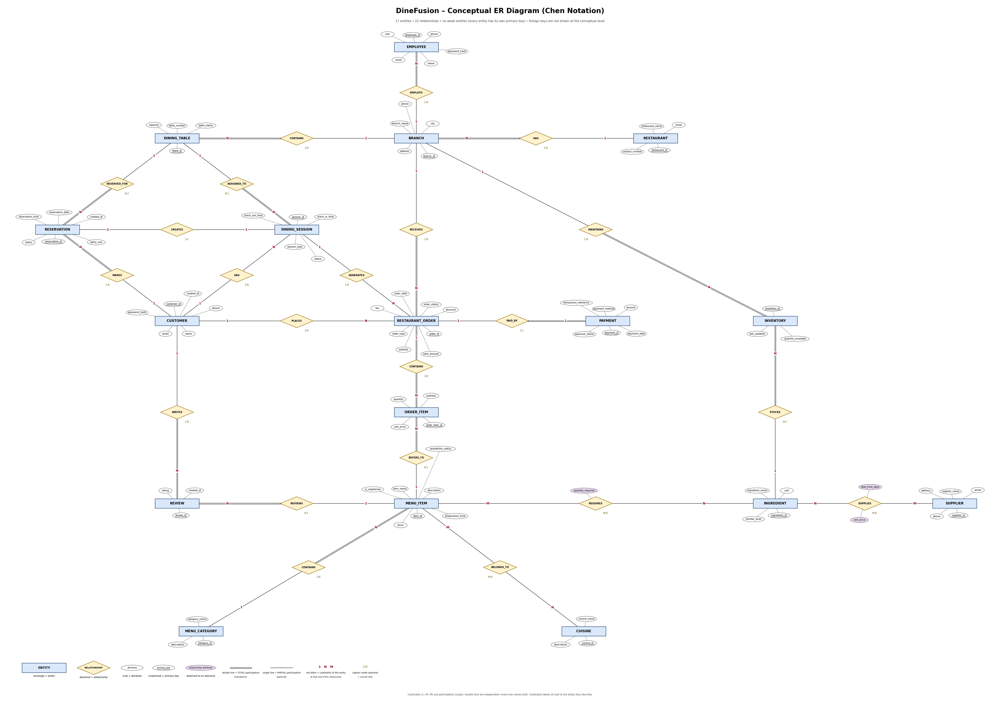
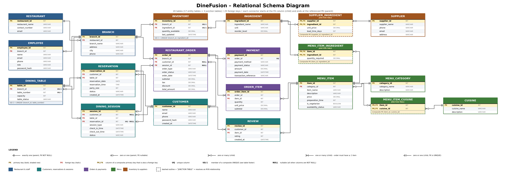

# DineFusion – Multi-Cuisine Restaurant Intelligence and Management System

## Project Overview

DineFusion is a DBMS mini-project designed to manage and analyze the operations of a multi-cuisine restaurant brand operating across multiple branches.

The system focuses on restaurant operations such as customer management, employee management, table reservations, dining sessions, menu management, orders, payments, inventory, suppliers, and customer reviews.

The project is designed as a simple but functional end-to-end application, with the primary emphasis on database design, SQL implementation, transaction management, and database technologies rather than complex frontend development.

## Project Objectives

- Design a normalized relational database for restaurant management.
- Manage restaurant branches, customers, employees, and dining tables.
- Handle reservations, dining sessions, orders, and payments.
- Maintain menu items, cuisines, ingredients, suppliers, and inventory.
- Store and manage customer reviews.
- Apply SQL queries, constraints, joins, subqueries, functions, procedures, and triggers.
- Implement transaction management and concurrency control.
- Explore NoSQL databases, graph databases, caching, and vector search.
- Develop a lightweight web application integrated with the databases.

## Technology Stack

| Component | Technology |
|---|---|
| Relational Database | MySQL 8 |
| Database Management Tool | MySQL Workbench |
| Document Database | MongoDB |
| Graph Database | Neo4j |
| In-memory Database / Cache | Redis |
| Vector Database | To be finalized |
| Frontend and Full-stack Framework | Next.js |
| Version Control | Git and GitHub |

*Technologies will be integrated progressively as the project develops.*

---

## Database Design Diagrams

### 1. Chen ER Diagram

The Chen ER diagram represents the conceptual database design, including entities, attributes, relationships, and cardinalities.



[View Chen ER Diagram](Phase-2-Database-Design/DineFusion_Chen_ER_Diagram.png)

### 2. Relational Schema Diagram

The relational schema diagram represents the conversion of the conceptual ER model into relational tables, including primary keys and foreign key relationships.



[View Relational Schema Diagram](Phase-2-Database-Design/DineFusion_Relational_Schema_Diagram.png)

---

## Project Development Roadmap

The project is divided into 12 phases.

| Phase | Description | Status |
|---|---|---|
| Phase 1 | Project Requirements and Scope | Completed |
| Phase 2 | Chen ER Diagram and Relational Schema | Completed |
| Phase 3 | Database Normalization | Completed |
| Phase 4 | MySQL DDL and DML | Completed |
| Phase 5 | Advanced SQL | Completed |
| Phase 6 | Functions, Stored Procedures and Triggers | Completed |
| Phase 7 | Transactions and Concurrency | Prepared – Execution and verification pending |
| Phase 8 | MongoDB | Planned |
| Phase 9 | Neo4j and Redis | Planned |
| Phase 10 | Vector Database | Planned |
| Phase 11 | Next.js Full-stack Application | Planned |
| Phase 12 | Testing, Documentation and Final Demonstration | Planned |

## Phase-wise Development Details

### Phase 1 – Project Requirements and Scope

**Status: Completed**

- Defined project scope and objectives.
- Identified the main entities and functional requirements.
- Established restaurant management system requirements.
- Defined the project as a multi-branch restaurant management system.

### Phase 2 – Chen ER Diagram and Relational Schema

**Status: Completed**

- Designed the conceptual Chen ER diagram.
- Identified entities, attributes, relationships, and cardinalities.
- Converted the ER model into a relational schema.
- Prepared the data dictionary.
- Documented entity relationships and assumptions.

### Phase 3 – Database Normalization

**Status: Completed**

- Analyzed the relational schema.
- Identified functional dependencies.
- Evaluated relations against 1NF, 2NF, 3NF, and BCNF under documented assumptions.
- Prepared the normalization report.

### Phase 4 – MySQL DDL and DML

**Status: Completed**

- Created the `dinefusion_db` database.
- Implemented 20 relational tables.
- Defined primary keys, foreign keys, unique constraints, and check constraints.
- Inserted sample data into the tables.
- Practiced SQL INSERT, UPDATE, and DELETE operations.
- Prepared database verification queries.

### Phase 5 – Advanced SQL

**Status: Completed**

Topics covered:

- INNER JOIN, LEFT JOIN, and RIGHT JOIN.
- Multi-table joins.
- Aggregate functions.
- GROUP BY and HAVING.
- Nested subqueries.
- Correlated and uncorrelated subqueries.
- Set operations such as UNION and UNION ALL.
- Built-in SQL functions.
- SQL views.

### Phase 6 – Functions, Stored Procedures and Triggers

**Status: Completed**

Topics covered:

- User-defined SQL functions.
- Stored procedures.
- IN, OUT, and INOUT parameters.
- Conditional statements using IF and CASE.
- Loops using WHILE, REPEAT, and LOOP.
- BEFORE and AFTER triggers.
- Data validation triggers.
- Inventory management triggers.
- Payment management triggers.
- Audit logging and verification.

### Phase 7 – Transactions and Concurrency

**Status: SQL files prepared; execution and verification pending**

Topics covered in the prepared scripts:

- Transaction fundamentals.
- ACID properties.
- START TRANSACTION, COMMIT, and ROLLBACK.
- SAVEPOINT and partial rollback.
- Transaction isolation levels.
- Dirty reads.
- Non-repeatable reads.
- Phantom reads.
- Lost updates.
- Row-level locking using FOR UPDATE and FOR SHARE.
- Deadlock demonstration and prevention.
- Transaction verification.

### Phase 8 – MongoDB

**Status: Planned**

- Document-oriented database concepts.
- MongoDB collections and documents.
- CRUD operations.
- Queries and aggregation.
- Integration with DineFusion use cases.

### Phase 9 – Neo4j and Redis

**Status: Planned**

**Neo4j:**
- Graph database concepts.
- Nodes and relationships.
- Cypher queries.
- Restaurant, menu, ingredient, and customer relationship analysis.

**Redis:**
- Key-value data storage.
- Caching.
- Session and temporary data management.
- Redis commands and operations.

### Phase 10 – Vector Database

**Status: Planned**

- Vector database fundamentals.
- Embeddings.
- Similarity search.
- Semantic search for menu items and customer reviews.

### Phase 11 – Next.js Full-stack Application

**Status: Planned**

Develop a simple but functional application with three interfaces:

**Customer Interface**
- Customer registration and login.
- Browse menu items.
- Add items to cart.
- Place orders.
- Simulated payment.
- View order history.
- Submit reviews.

**Restaurant Staff Interface**
- View incoming orders.
- Update order status.
- Manage restaurant service.

**Admin Interface**
- Manage branches.
- Manage menu items and categories.
- Manage employees.
- Manage inventory.
- View reports and analytics.

The frontend will remain lightweight, with the main development emphasis on backend logic and database integration.

### Phase 12 – Testing, Documentation and Final Demonstration

**Status: Planned**

- Database testing.
- SQL query verification.
- Backend and API testing.
- Frontend testing.
- Database integration testing.
- Authentication and authorization testing.
- Project documentation.
- Final project demonstration.

---

## Database Overview

The current MySQL implementation contains 20 relational tables:

1. RESTAURANT
2. BRANCH
3. CUSTOMER
4. EMPLOYEE
5. DINING_TABLE
6. RESERVATION
7. DINING_SESSION
8. RESTAURANT_ORDER
9. ORDER_ITEM
10. PAYMENT
11. CUISINE
12. MENU_CATEGORY
13. MENU_ITEM
14. MENU_ITEM_CUISINE
15. INGREDIENT
16. MENU_ITEM_INGREDIENT
17. SUPPLIER
18. SUPPLIER_INGREDIENT
19. INVENTORY
20. REVIEW

The database uses primary keys, foreign keys, composite relationships, unique constraints, and check constraints to maintain data integrity.

---

## Project Folder Structure

```text
DineFusion/
│
├── Phase-1-Requirement-Analysis/
│   └── Phase_1_Requirement_Analysis.docx
│
├── Phase-2-Database-Design/
│   ├── DineFusion_Chen_ER_Diagram.drawio
│   ├── DineFusion_Chen_ER_Diagram.png
│   ├── DineFusion_Relational_Schema.mmd
│   ├── DineFusion_Relational_Schema_Diagram.png
│   ├── 03_Data_Dictionary.xlsx
│   ├── 04_Normalization_Notes.docx
│   └── 05_ER_Relationships_and_Cardinalities.docx
│
├── Phase-3-Normalization/
│   └── Normalization_Report.docx
│
├── Phase-4-MySQL-Database/
│   ├── 01_create_database.sql
│   ├── 02_create_tables.sql
│   ├── 03_insert_sample_data.sql
│   ├── 04_update_delete.sql
│   └── 05_verification_queries.sql
│
├── Phase-5-Advanced-SQL/
│   ├── 01_joins.sql
│   ├── 02_aggregate_groupby_having.sql
│   ├── 03_subqueries.sql
│   ├── 04_set_operations.sql
│   ├── 05_sql_functions.sql
│   └── 06_sql_views.sql
│
├── Phase-6-Functions-Procedures-Triggers/
│   ├── 01_user_defined_functions.sql
│   ├── 02_stored_procedures.sql
│   ├── 03_procedure_parameters.sql
│   ├── 04_conditional_procedures.sql
│   ├── 05_before_after_triggers.sql
│   ├── 06_inventory_triggers.sql
│   ├── 07_payment_triggers.sql
│   └── 08_testing_verification.sql
│
├── Phase-7-Transactions-Concurrency/
│   ├── 01_transaction_commit_rollback.sql
│   ├── 02_savepoints.sql
│   ├── 03_isolation_levels.sql
│   ├── 04_concurrency_problems.sql
│   ├── 05_row_locking.sql
│   ├── 06_deadlock_demo.sql
│   ├── 07_transaction_testing.sql
│   └── README.md
│
├── Documentation/
│   └── Phase progress documentation
│
└── README.md
```

---

## How to Run the MySQL Database

### Requirements

- MySQL Server 8.x
- MySQL Workbench
- Git

### Initial Database Setup

1. Clone the DineFusion repository.
2. Open MySQL Workbench.
3. Connect to your local MySQL server.
4. Open the SQL files inside `Phase-4-MySQL-Database/`.
5. Execute the scripts in this order:

   - `01_create_database.sql`
   - `02_create_tables.sql`
   - `03_insert_sample_data.sql`
   - `04_update_delete.sql`
   - `05_verification_queries.sql`

6. Verify that all 20 tables and sample records are available.

### Running Later SQL Phases

Execute the SQL files in their respective folders:

- Phase 5 – Advanced SQL.
- Phase 6 – Functions, Procedures and Triggers.
- Phase 7 – Transactions and Concurrency.

Follow the instructions and execution order documented in each phase.

**Important:** Run the initial database creation and sample-data scripts on a clean database. Do not repeatedly execute the sample-data insertion script because it uses fixed IDs.

Phase 7 concurrency demonstrations require two separate MySQL Workbench connections to the same database. Follow the Session 1 and Session 2 instructions in the SQL comments instead of using Run All.

---

## End-to-End Application Workflow

The intended application workflow is:

1. Customer registers or logs in.
2. Customer browses available menu items.
3. Customer adds items to the cart.
4. Customer places an order.
5. Backend validates the order.
6. MySQL records the order and order items.
7. Inventory is updated safely using transactions.
8. A simulated payment is recorded.
9. Restaurant staff update the order status.
10. Customer views order history and submits a review.

This workflow connects the database concepts to actual restaurant operations.

---

## Collaboration and GitHub

Repository: [DineFusion – GitHub](https://github.com/anirudhm43/DineFusion)

To clone the repository:

```bash
git clone https://github.com/anirudhm43/DineFusion.git
cd DineFusion
```

To get the latest updates:

```bash
git pull origin main
```

Each contributor must execute the SQL scripts locally to recreate their own MySQL database. GitHub stores the project files, not the live contents of a local MySQL database.

For team collaboration, contributors should preferably work on separate branches and merge their changes into the main branch after review.

---

## Project Note

DineFusion is an academic DBMS mini-project being developed phase by phase.

The primary emphasis is on database design, normalization, SQL, transaction management, concurrency control, and database technologies. The web application will provide a simple and functional interface to demonstrate these concepts in a practical restaurant management workflow.